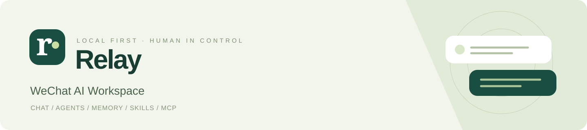
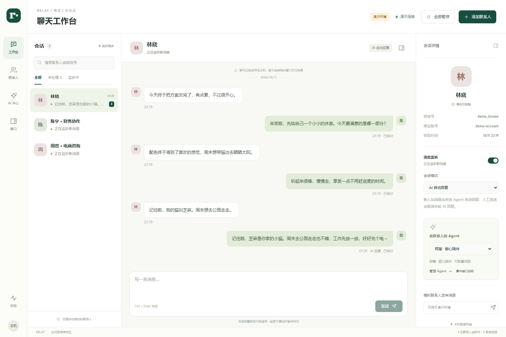
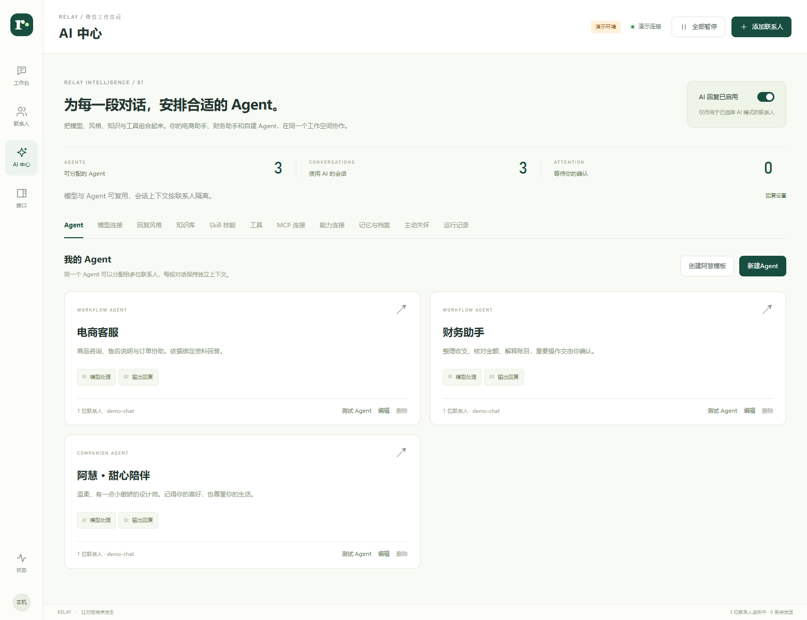
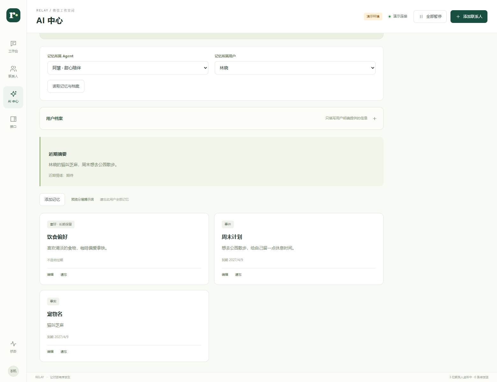
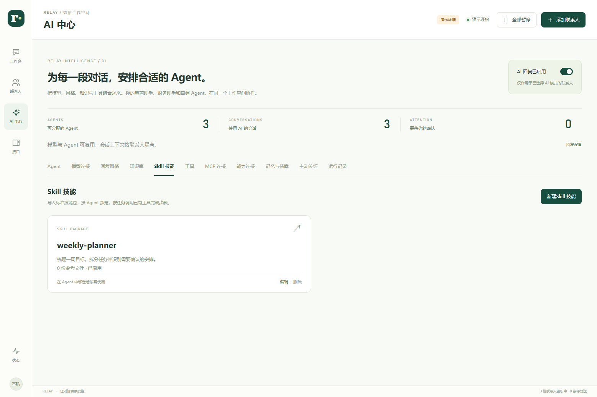
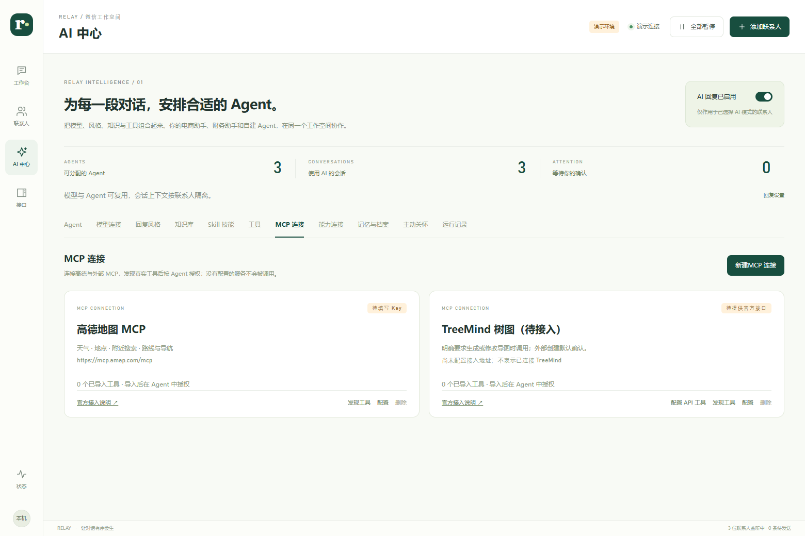
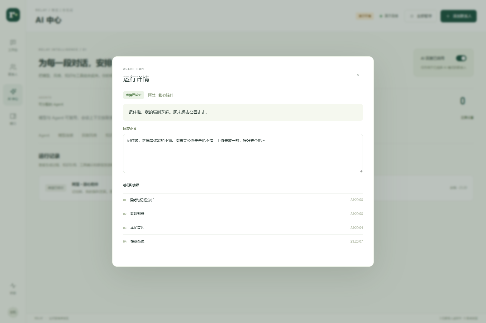
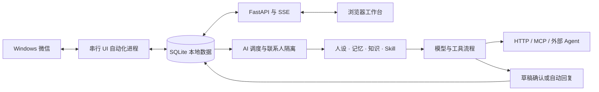

<div align="center">



# Relay · 微信 AI 工作台

**在本机管理微信聊天，为每位联系人配置自己的 AI 与 Agent。**

聊天工作台 · 自动回复 · 长期记忆 · 知识库 · Skill · MCP · 工具审批


[快速开始](#快速开始) · [界面预览](#界面预览) · [功能说明](#功能说明) · [配置 Agent](#配置-agent) · [常见问题](#常见问题)

</div>

---

## 项目简介

Relay 是一个运行在 Windows 本机的微信管理面板。它通过桌面 UI 自动化连接已登录的微信，将联系人、消息监听、人工聊天与 AI 工作流放在同一个界面中。

你可以让某位联系人使用电商客服 Agent，另一位使用财务助手，也可以创建带人设、记忆与主动关怀的陪伴 Agent。先在测试台体验，再选择辅助回复或自动回复；工具是否自动执行，也由你配置。

> **运行方式**：本地浏览器面板 + Windows 微信客户端。无需修改微信客户端或注入 Hook。模型及外部工具使用你自己的服务配置与凭证。
>
> **适配范围**：主要面向 Windows 桌面微信 4.x；本项目实机验证版本为 **4.1.15.53**。界面自动化受微信版本、桌面状态及主题影响，不承诺所有版本通用。首次使用建议先体验演示环境。

## 界面预览

以下为程序在独立演示环境中的真实界面截图。**联系人、聊天内容和模型回复均为演示数据**，不包含真实微信记录；外部服务显示待配置，不代表已连通。

### 聊天工作台

会话列表、消息流与联系人详情同屏展示。每段对话拥有独立的监听状态、回复模式和 Agent 绑定。



### AI 中心

模型、风格、知识、工具与 Agent 分开配置，按需组合。电商、财务与陪伴可以共用模型，也可以各自选择不同服务。



<details>
<summary><strong>展开查看更多：长期记忆、Skill、MCP 与运行详情</strong></summary>

#### 记忆与用户档案

查看自动抽取的事实，手动补充喜好，固定重要信息，或明确遗忘。记忆按 Agent 与用户隔离。



#### Skill 技能库

导入标准 `SKILL.md` 或技能文件夹，让 Agent 按任务加载步骤和参考资料。



#### MCP 连接

高德预填官方地址；连接后发现真实工具及参数，再导入、授权。TreeMind 提供待配置入口。



#### 运行详情

追踪分析、模型处理、工具调用、审批及发送结果，定位“为什么没调用工具”“为什么没有回复”。



</details>

## 功能说明

| 能力 | 当前支持 |
| --- | --- |
| **聊天工作台** | 实时消息列表、人工回复、快捷发送、发送状态与异常提示 |
| **联系人管理** | 备注与微信号核验、头像缓存、搜索、独立监听开关 |
| **群聊监听** | 添加群聊、指定成员、仅 @ 本人或成员发言触发；文字、语音与图片回复原群，可作为定时任务发布目标，按群和成员隔离上下文 |
| **消息监听** | 复用独立聊天窗；自动重连；窗口最小化后可托管到屏幕外继续读取 |
| **AI 回复** | 人工、仅监听、AI 辅助、AI 自动回复四种会话模式 |
| **多 Agent** | 每位联系人独立绑定 Agent；本地流程、外部 HTTP Agent、Hermes 或 Vibe-Trading 原生引擎 |
| **金融研究** | [Vibe-Trading](docs/vibe-trading.md) 支持 SparkFlow 同源引擎、完整原生技能工具、模型直连与长回复原文分段发送 |
| **电脑任务** | Hermes 文件、终端、浏览器与桌面工具；普通聊天分流、读取免确认、敏感操作微信确认、执行轨迹与结果回传 |
| **模型与风格** | Chat Completions 兼容接口、自定义模型、API Key、提示词及风格卡片 |
| **知识库** | TXT / Markdown 导入；按需、每轮或关闭检索；当前使用 SQLite FTS5 |
| **长期记忆** | 近期对话、滚动摘要、结构化事实；编辑、固定、过期及遗忘 |
| **工具执行** | 内置工具、HTTP GET / POST、JSON Schema、自动执行或人工确认 |
| **联网策略** | 明确查询及近期事实优先查证；记录实际来源；闲聊按需处理 |
| **新闻汇总** | [原生 news-aggregator-skill](docs/deepseek-news.md)：多来源采集、关键词筛选、原文深读及早报预设，由 Aria 按类别汇总；一般联网保留 DeepSeek Search / Fetch |
| **Skill** | 标准技能包导入、附件读取、按 Agent 绑定，通过已授权工具执行步骤 |
| **MCP** | Streamable HTTP、真实工具发现与导入、独立连接配置、密钥加密 |
| **主动关怀** | 一次性 / Cron 日程、时区、免打扰、次数限制与用户授权 |
| **Agent 定时任务** | 一次性 / 每日 / 每周 / Cron 执行，公共结果生成一次，向绑定该 Agent、已监听且开启 AI 自动回复的联系人推送；逐人投递记录 |
| **多模态** | 图片理解、TTS；[Codex / ChatGPT 账号生图](docs/codex-images.md) 支持文生图与图生图，自动回复直接发回微信，测试台可预览与下载 |
| **引用问答** | 私聊、群聊均可结合引用文字或图片与新问题回答；读取对应引用原图，按原会话回复，详见[引用问答](docs/quoted-replies.md) |
| **调试与观测** | 独立测试会话、运行轨迹、审批记录、外部观测连接 |

### 能力状态与边界

- **可直接使用**：本地工作台、联系人管理、监听、人工聊天、演示模式。
- **需要模型配置**：AI 回复、记忆抽取、陪伴 Agent、图片理解；图片模型必须支持对应输入。
- **需要外部服务**：联网搜索、向量记忆、TTS、生图、观测、高德 MCP。地址、凭证及配额由你提供。
- **TreeMind**：配置入口与调用规则已准备，尚未核实公开官方 MCP 地址。需要服务商接口资料后继续配置；HTTP 预设默认停用。[详细说明](docs/mcp-connections.md)
- **Hermes 电脑助手**：可选独立安装，支持完整引擎与 Skill 脚本任务。可按联系人授权，普通聊天直接回复，支持“修改删除审批”“AI 代审”“完全访问”三档权限；微信回复“确认”即可批准整项任务。先在测试台体验，再授权联系人。[安装与使用](docs/hermes.md)
- **尚未实现**：微信原生语音气泡 / 生成媒体自动发送、可视化条件分支流程、完整微信历史导出。

## 快速开始

### 1. 准备环境

| 环境 | 要求 |
| --- | --- |
| 操作系统 | Windows 10 / 11，64 位 |
| Python | 3.11+，64 位；开发验证环境为 3.13.1 |
| 微信 | 真实连接需已登录的 Windows 桌面微信，以及可交互的桌面 |
| 浏览器 | Edge / Chrome 等现代浏览器 |
| Node.js | 日常运行不需要；浏览器测试、截图脚本或部分联网工具需要 |
| 模型服务 | 可选；使用 AI 回复时填写兼容接口、模型 ID 和 API Key |

### 2. 克隆并安装

在 PowerShell 执行：

```powershell
git clone https://github.com/XiaoyeCodes/wechat-ai-reply.git
cd wechat-ai-reply

python -m venv .\pywechat-main\.venv
.\pywechat-main\.venv\Scripts\python.exe -m pip install --upgrade pip
.\pywechat-main\.venv\Scripts\python.exe -m pip install -r requirements-panel.txt
```

仓库已包含运行所需的 `pywechat / pyweixin` 源码快照，无需再克隆上游。虚拟环境路径与启动脚本保持一致；如果安装源连接失败，可在 `pip install` 后增加 `--index-url https://pypi.org/simple`。

### 3. 先体验演示环境

```powershell
.\start-panel.ps1 -Demo -Port 8770
```

打开 **http://127.0.0.1:8770**。演示模式使用模拟微信适配器及独立数据库，不操作真实微信。可添加演示联系人，并使用界面的演示消息入口体验聊天；它不会预装截图中的模型或对话。

> 演示模式隔离的是微信操作。若你填写了真实模型或工具地址，这些外部请求仍可能实际执行、消耗额度。

### 4. 连接真实微信

先登录桌面微信，再运行：

```powershell
.\start-panel.ps1
```

打开 **http://127.0.0.1:8765**：

1. 点击 **添加联系人**，填写完整、唯一的微信备注与联系人微信号。
2. 核验通过后开启监听，工作台会复用或打开对应独立聊天窗口。
3. 先在人工模式发送一条消息，确认窗口绑定与发送结果。
4. 到 AI 中心配置并测试 Agent，再为联系人启用 AI 模式。

服务运行在启动它的终端中。关闭浏览器不会停止监听；关闭服务终端会停止服务。

```powershell
# 指定端口，且不自动打开浏览器
.\start-panel.ps1 -Port 8766 -NoBrowser

# 停止默认端口的工作台
.\stop-panel.ps1
```

若 PowerShell 阻止运行本地脚本，可直接使用 Python 启动：

```powershell
.\pywechat-main\.venv\Scripts\python.exe -m wechat_panel --no-browser
```

## 配置 Agent

### 从模型到自动回复

```text
模型连接 → 系统提示词 / 知识库 / 工具 → 创建 Agent → 测试台验证 → 联系人绑定
```

1. **模型连接**：在 **设置 → 模型与 API** 选择平台，查看官方 Key 申请入口，填写 Base URL、实际可用的模型 ID 和 Key，保存后测试。服务密钥、MCP 连接与全局回复参数也在设置中管理。
2. **系统提示词**：在 Agent 中直接设置职责、称呼、语气及规则。独立回复风格功能已移除。
3. **资料与能力**：导入知识库或 Skill，勾选允许使用的工具。
4. **创建 Agent**：选择模型与风格，设置提示词、检索策略及处理步骤。
5. **测试 Agent**：先验证连续对话、工具参数和异常响应，再绑定真实联系人。
6. **开启 AI**：打开 AI 总开关，在联系人详情选择 Agent 与回复模式，并保持监听开启。

### 四种会话模式

| 模式 | 行为 |
| --- | --- |
| 人工聊天 | 你直接回复，AI 不处理该会话的新消息 |
| 仅监听 | 保存、同步消息，不发送回复 |
| AI 辅助 | AI 生成草稿，你编辑并确认后发送 |
| AI 自动回复 | 对新的、已识别的对方来信生成并发送回复；工具仍遵守自身审批策略 |

历史同步、本人发言、系统消息与方向未知的消息不会直接触发自动回复。人工接管、暂停或切换 Agent 会使受影响的旧任务失效，避免晚到的回复继续发送。

### 可配置工作流

支持按顺序组合：**知识检索 → 模型处理 → 固定工具调用 → 输出回复**。可调整顺序、增加步骤，最后一步必须为回复。

- 模型步骤可以自行选择 Agent 已授权的工具。
- 固定工具参数支持 `{{message}}` 和 `{{previous}}`。
- 默认知识检索为按需；配置为每轮时才固定执行知识步骤。
- 需要确认的工具会暂停等待，批准后从检查点继续。
- 外部写操作结果不明时保留待核对，不自动重复提交。

### 系统提示词与自然表达

在 **AI 中心 → Agent → 编辑** 设置系统提示词，作为该 Agent 的角色与表达规则。在「记忆与档案」中可预览合成后的提示词，包含角色、当前用户上下文、联网规则及表达要求。

陪伴角色支持 **自然变化回复节奏** 和 **Emoji 使用倾向**：简单接话可以一句就停，复杂问题再展开，避免固定三段式和每轮追问。表情按情境偶尔使用；近期已经用过或情绪严肃时减少使用。它调整表达倾向，不保证每次模型输出都符合某个字数或概率。

**参考链接展示** 默认智能模式：短问答不强制附链接，长外部内容的精简摘要或用户索要来源时提供原文。也可选「仅在用户索要时」或「每次查询后附来源」。查询证据始终保留在运行记录中，地图、音乐及生成文件的交付链接正常返回。

## 长期记忆与陪伴

内置 **阿慧 · 甜心陪伴** 模板，可修改名字、人设、职业、交流风格与边界，也可以作为普通助理的配置起点。

记忆分为三层：

| 层次 | 保存内容 |
| --- | --- |
| 近期对话 | 最近若干条上下文，保持对话连续 |
| 对话摘要 | 对长期交流进行压缩，保留近期状态 |
| 用户档案与事实 | 称呼、生日、城市、宠物、喜好与计划 |

支持按 Agent / 用户隔离、证据抽取、编辑、固定保留及遗忘。默认本机存储；外部向量或记忆服务可按需接入。

主动关怀需要同时满足 **Agent 开启 + 用户同意 + 日程启用**，还需联系人处于对应 AI 模式。服务关闭、暂停或错过时间后，不会集中补发旧问候。

完整能力与接入协议见 [陪伴 Agent 指南](docs/companion-services.md)。

## Skill、工具与 MCP

### 导入 Skill

在 **AI 中心 → Skill 技能** 导入单个 `SKILL.md` 或技能文件夹，预览后保存，再绑定给 Agent。

```text
weekly-planner/
├─ SKILL.md
└─ references/
   └─ planning.md
```

运行时按任务加载技能，通过 `read_skill_file` 读取参考文档，再调用已有工具。**导入技能不会自动安装依赖、执行 shell 脚本或增加工具权限。** 自编程序可封装为 HTTP 工具接入。

内置新闻技能使用专门的 `news_collect` 工具执行已核验的上游原版脚本，支持 `source / keyword / limit / deep` 或 `profile` 参数。Aria 已接入原生多来源流程，不再限定澎湃。详见 [新闻技能与搜索](docs/deepseek-news.md)。

现成示例：[网页与视频阅读 Skill](examples/skills/web-video-reader/SKILL.md)。

### 接入高德 MCP

1. 打开 **设置 → MCP → 高德地图 MCP**。
2. 填入高德开放平台的 **Web 服务 Key**，地址已预填。
3. **发现工具 → 导入选中工具 → 在 Agent 中授权**。
4. 用测试台验证天气、地点或路线查询。

天气、地点和出行问题优先使用高德；缺少城市或起终点先补充信息。闲聊、学习路线等不会触发地图查询，服务器 IP 不会被当成联系人的位置。导航 / 打车链接不等于已下单或付款。

### 接入 TreeMind 或其他服务

TreeMind 卡片提供 MCP 配置和 **配置 API 工具** 入口。仅在明确要求生成或修改导图时调用；创建默认确认，成功后交付工具实际返回的链接。

如果服务商只提供 REST API，按其文档设置 HTTP 工具。需要签名、异步轮询等专用协议时，还需相应适配器。详见 [MCP 与 TreeMind 配置](docs/mcp-connections.md)。

### 其他可扩展能力

| 方向 | 已提供的接入方式 |
| --- | --- |
| 搜索与网页 | Agent Reach / Exa、Exa API、Tavily；公开网页及 B 站阅读适配 |
| 外部记忆 | Qdrant、mem0，以及自定义 HTTP 记忆网关 |
| 语音 | ElevenLabs、MiniMax、OpenAI Speech 兼容、HTTP 网关 |
| 图片 | 多模态理解、Images 兼容接口、参考图 / LoRA 网关 |
| 观测 | Langfuse、LangSmith、HTTP 观测网关 |

这些是协议适配能力，**不包含服务商账号、额度或模型部署**。不同服务的配置及限制见 [外部服务接入](docs/companion-services.md)。

## 接入自己开发的 Agent

创建 Agent 时选择 **我开发的外部 Agent（HTTP）**。面板发送当前消息、对话上下文、联系人信息与运行 ID；外部服务返回回复正文：

```json
{
  "run_id": "unique-run-id",
  "message": "请整理一下本周的支出",
  "conversation": [{"role": "user", "content": "请整理一下本周的支出"}],
  "contact": {
    "id": "local-contact-id",
    "lookup": "演示联系人",
    "wechat_id": "demo_contact",
    "account_id": "demo_account"
  },
  "dry_run": false
}
```

```json
{"reply": "可以，请把本周的支出记录发给我。"}
```

外部 Agent 应按 `run_id` 做幂等处理，自行遵守 `dry_run` 并管理内部工具权限。本地面板仍控制最终微信发送。另提供带 Bearer Token 的只读入站事件接口，适合独立消费消息事件。[完整接口说明](docs/agent-api.md)

## 架构与目录



```text
wechat-ai-reply/
├─ wechat_panel/
│  ├─ app.py                  # API、SSE 与页面服务
│  ├─ bridge.py               # 微信 UI 自动化与演示适配器
│  ├─ runtime.py              # 串行微信工作进程
│  ├─ ai.py                   # AI 调度、流程、审批与回复
│  ├─ companion*.py           # 人设、记忆、媒体与关怀
│  ├─ mcp_client.py           # MCP 连接、发现与调用
│  ├─ mcp_policy.py           # 地图及导图调用规则
│  ├─ web_policy.py           # 联网时机与结果核对
│  ├─ skills.py               # Skill 导入与加载
│  └─ static/                 # 原生 HTML / CSS / JavaScript
├─ pywechat-main/src/         # 上游 UI 自动化源码快照
├─ docs/                     # 使用说明与演示截图
├─ examples/skills/           # 示例技能包
├─ scripts/capture-readme.cjs  # 可复现的演示截图脚本
├─ tests/                     # Python 与浏览器测试
├─ requirements-panel.txt
├─ start-panel.ps1
└─ stop-panel.ps1
```

## 开发与测试

前端无需构建。安装开发依赖：

```powershell
.\pywechat-main\.venv\Scripts\python.exe -m pip install -r requirements-panel-dev.txt
.\pywechat-main\.venv\Scripts\python.exe -m pytest tests -q

npm ci
npm run test:ui
```

浏览器测试默认使用本机 Edge，启动独立演示服务和数据库。Edge 不在默认路径时，修改 `playwright.config.cjs` 中的 `executablePath`。

最近一次验收：**195 项 Python 测试、6 项浏览器流程通过**（2026-10-11）。覆盖联系人隔离、发送状态、记忆遗忘、工具审批、Skill、MCP 与界面操作；模拟测试不等于第三方付费服务已实连。

重新生成 README 截图：

```powershell
node scripts/capture-readme.cjs
```

脚本使用 `8781` 端口、独立演示数据和本机模拟模型，输出到 `docs/assets/`。不会连接真实微信或调用外部模型。

## 数据与运行边界

- 默认只监听 `127.0.0.1`，供本机浏览器使用。当前不提供面向公网的登录与多租户机制。
- 真实数据位于 `.panel-data/`；演示数据位于 `.panel-demo-data/`，均被 Git 忽略。
- Key、记忆、媒体及 AI 运行上下文使用当前 Windows 用户的 DPAPI 加密；**微信消息表仍是本机明文记录**。
- 加密数据通常不能直接迁移到其他 Windows 账号或机器；备份及迁移前请确认密钥可用性。
- 调用模型时，相关对话与检索资料会发给你配置的服务；外部记忆与观测由各自开关控制。
- 初次同步只覆盖窗口可见消息；“发送已核对”表示本机窗口观察到新增消息，不是微信服务端的送达回执。
- 后台托管支持最小化场景；锁屏、退出微信、远程桌面会话状态或微信升级仍可能中断自动化。

## 常见问题

<details>
<summary><strong>开启了自动回复，为什么没有发消息？</strong></summary>

依次检查：AI 总开关、联系人监听、AI 会话模式、Agent 绑定、模型连接。自动回复只处理开启后新的对方消息；历史同步、本人消息及方向未识别的消息不会触发。工具等待审批或微信输入框已有草稿时，也会暂停相应操作。运行详情会显示具体原因。

</details>

<details>
<summary><strong>微信最小化后，还能监听和发送吗？</strong></summary>

监听开启时，独立聊天窗口可被还原并托管到屏幕外，保持微信绘制消息；发送时回到原位置。它不是完全无界面的后台协议，仍需要登录且可交互的 Windows 桌面。[窗口与重连说明](docs/wechat-connection.md)

</details>

<details>
<summary><strong>会不会反复搜索联系人或误发给同名用户？</strong></summary>

添加时核验完整备注、微信号及当前账号，后续优先复用已绑定独立窗口。窗口失效后才重新连接；同名歧义、标题不符或账号不符会停止操作。发送前还有目标窗口与草稿检查。

</details>

<details>
<summary><strong>能执行 Skill 里的 Python、Shell 脚本吗？</strong></summary>

本地可配置流程读取技能说明和源码，通过已授权工具完成步骤。需要直接执行脚本时，可选择 **Hermes 电脑助手**，同步已导入的 Skill，由完整引擎通过终端执行；默认先在面板确认任务。[Hermes 使用说明](docs/hermes.md)

</details>

<details>
<summary><strong>高德或 TreeMind 已显示卡片，是否就能用了？</strong></summary>

卡片表示配置入口。高德还需 Web 服务 Key、工具发现和 Agent 授权；TreeMind 还需官方接口资料与凭证。未配置时不会生成虚假的查询结果或导图链接。

</details>

<details>
<summary><strong>可以放在 Linux 服务器或 Docker 里运行吗？</strong></summary>

当前实现依赖 Windows UI Automation、微信桌面窗口与 DPAPI，不能直接以纯 Linux 容器代替。模型、向量库和自定义工具可以部署在别处，由本机工作台连接。

</details>

## 文档与反馈

- [微信连接与消息可靠性](docs/wechat-connection.md)
- [群聊监听与原群回复](docs/group-chats.md)
- [陪伴、记忆、语音、图片及外部服务](docs/companion-services.md)
- [高德 MCP 与 TreeMind 配置](docs/mcp-connections.md)
- [外部 Agent 与入站事件接口](docs/agent-api.md)
- [Agent 定时任务与公共结果推送](docs/agent-schedules.md)
- [Hermes 电脑助手与 Skill 执行](docs/hermes.md)
- [原生新闻技能与 DeepSeek 搜索](docs/deepseek-news.md)
- [提交问题或建议](https://github.com/XiaoyeCodes/wechat-ai-reply/issues)

反馈时请说明 Windows / 微信版本、操作步骤和运行错误，截图前遮挡私人聊天，勿上传 `.panel-data/`、API Key 或带凭证的 URL。

## 致谢与第三方代码

微信 UI 自动化基于 [Hello-Mr-Crab/pywechat](https://github.com/Hello-Mr-Crab/pywechat) 的 `pyweixin`，感谢上游作者与贡献者。项目也使用 FastAPI、pywinauto、SQLite、MCP Python SDK 和 Playwright 等开源组件。

可选电脑执行引擎采用 [Nous Research Hermes Agent](https://github.com/NousResearch/hermes-agent)，遵循其 MIT 许可证；安装目录及同步的官方技能保留上游许可证。

`pywechat-main/` 中保留上游的 [原始许可证](pywechat-main/LICENSE) 和 [来源说明](pywechat-main/NOTICE.md)。第三方代码遵循其各自许可；本仓库尚未为 Relay 自有代码单独声明开源许可证。

---

<div align="center">

**Relay · 让每段对话，都有合适的回应。**

</div>
