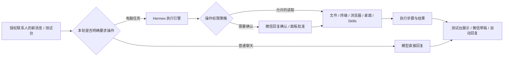

# Hermes 电脑助手

Relay 可以把微信任务交给完整的 [Nous Research Hermes Agent](https://github.com/NousResearch/hermes-agent) 执行。Hermes 使用 [MIT 许可证](https://github.com/NousResearch/hermes-agent/blob/v0.22.2/LICENSE)。当前独立安装固定为 **v0.22.2**，不会覆盖已有的全局 Hermes 安装。



## 安装与配置

先完成主项目安装，并安装 Git for Windows。在项目目录执行：

```powershell
.\scripts\install-hermes.ps1
# 网络需要代理时：
.\scripts\install-hermes.ps1 -Proxy http://127.0.0.1:7890
```

脚本下载固定版本源码，通过上游包管理器安装独立 Python、依赖及工具，包括浏览器和 Windows 桌面驱动。首次安装需下载较多文件；不需要 WSL。

1. 打开 **AI 中心 → 新建 Agent**。
2. 来源选择 **Hermes 电脑助手（完整执行引擎）**。
3. 运行方式选择 **本机托管**，选一个支持工具调用的模型连接。
4. 可填写已有文件夹作为起始工作目录，填写电脑助手系统提示词。
5. 联系人保留 **仅在测试台使用**，电脑操作权限选择 **修改、删除需审批，读取自动执行**。
6. 保存后点击卡片的 **检查引擎**，再点击 **测试 Agent**。

例如：

> 在工作目录新建 hello.txt，写入“你好 Hermes”，然后读回核对内容。

读取步骤可自动执行，首次需要更改文件时确认整项任务。**测试台会实际操作电脑，只是不发送微信消息。** 引擎随首次检查或任务自动启动，随工作台退出停止。

## 从微信使用

编辑此 Agent，选择允许下达任务的联系人；每个电脑 Agent 只授权一位联系人。然后在该联系人的会话详情绑定这个 Agent，并开启监听和 AI 模式：

- **AI 辅助**：执行结束生成草稿，由你确认后发回微信。
- **AI 自动回复**：执行结果经过现有联系人及消息检查后进入微信发送队列。
- **微信确认**：需要批准时，在微信中查看任务说明并回复“确认”或“取消”。同一任务只确认一次。

任务策略控制何时开始任务，电脑操作权限控制每次工具调用。普通聊天路由开启且有模型连接时，闲聊直接回复，含糊的请求先澄清；只有本轮明确要求操作才交给 Hermes。

### 三档电脑操作权限

在 **AI 中心 → 编辑 Hermes Agent → 电脑操作权限** 中选择，配置按 Agent 独立保存：

| 权限 | 行为 |
| --- | --- |
| **1. 修改、删除需审批，读取自动执行** | 文件读取、目录查询、查看配置和公开网页搜索自动执行；需要创建、写入、修改、删除或无法判断影响时，请用户确认 |
| **2. AI 代审，敏感操作由用户确认** | 对普通操作，由模型审查实际参数与用户本轮任务是否相符。明确的普通操作可自动通过；覆盖、删除、对外发送、账号/系统变更、凭证访问和无法判断的操作交给用户 |
| **3. 完全访问，无需任何审批** | 明确任务直接执行，不出现任务或工具审批。普通聊天仍直接回复；联系人授权、取消任务和操作系统本身的权限仍然有效 |

前两档采用**整项任务确认一次**。比如“在桌面建文件夹，保存今天的聊天记录”，确认后，定位目录、创建文件夹、写入和核对可以连续完成；新任务重新判断权限。AI 自动通过某一步不等于用户批准整项任务，后续敏感操作仍会请求用户确认。

微信示例：

```text
这项任务需要你确认一次：
任务：在桌面新建文件夹，保存今天的聊天记录。
准备：查找桌面和聊天记录，创建文件夹并保存记录。
涉及：电脑桌面、今天的聊天记录。
影响：桌面会新增文件夹和记录文件。

回复「确认」继续，或「取消」。
确认后连续完成本次任务，不再逐步询问；新任务重新判断权限。
```

不需要输入编号。程序只接受原联系人的新来信，且必须存在唯一有效的待确认任务；重复、过期、错误联系人或含糊的确认不会再次执行操作。保留旧版带编号回复的兼容处理。暂停、更换 Agent、服务重启或新任务会使旧确认失效。

确认说明由实际参数和用户任务生成，原始命令保留在运行详情的“查看技术详情”中。普通只读工具和明确的只读命令组合无需经过模型审批；AI 代审失败时交给用户确认。整项任务的确认授权仅保存在该次运行，不变成联系人或引擎会话的永久放行。

第一档无法判断用途的程序代码仍需用户确认；第二档先由 AI 检查普通操作，但不会仅凭执行模型自称“安全”放行已识别的敏感操作。工具调用策略**不是操作系统级文件沙箱**。

本机托管提供三档权限；远程 API 保留其原生审批配置。确认消息只在明确未开始输入、且被焦点或窗口遮挡中断时有限重试，发送结果不明确时不重发。细分权限插件未成功加载时，引擎不会开始任务。

联系人必须同时获得该 Hermes Agent 的授权并绑定到会话。遗漏授权时，面板会提示原因并阻止启用，避免出现收到消息却没有任务的情况。

历史聊天以背景资料传入，本轮来信单独作为执行指令；不会把历史中未回复的请求直接拼入当前任务。需要继续旧任务时，请在新消息中明确说明。

暂停、更换 Agent、人工接管、取消任务或收到新消息会使旧任务失效，并尝试停止远端执行。已经完成的文件修改或电脑操作不会自动撤销。工作台重启或提交结果不明确时保留待核对记录，**不会自动重放电脑任务**。

## 技能与扩展

- 在 **Skill 技能** 导入标准 `SKILL.md` / 技能文件夹，再在 Hermes Agent 中勾选同步。
- 本机托管引擎将选中的技能和附件放入独立 profile 的技能目录，Hermes 可加载说明并用终端执行其中的脚本。仅导入你信任的技能。
- 内置上游 `computer-use` 技能说明，指导先读取窗口、定位控件，再操作和验证。
- 取消绑定或更新技能时，旧版本归档到 `disabled-relay-skills`，不会继续出现在活动技能目录。
- Hermes 自身 MCP 配置可在其 profile 的 `config.yaml` 中配置。Relay 的 MCP、知识库、陪伴配置不会自动转换为 Hermes 配置。
- Hermes 的永久记忆属于对应 Agent 的 profile；同一 Agent 的任务可以复用它。更换使用者时新建一个 Hermes Agent，避免把旧使用者的永久记忆带给新使用者。
- 也可以选择 **连接已有 Hermes API 服务**，填写 API 根地址及 `API_SERVER_KEY`。这时模型、技能、工具和执行机器由该服务管理，不会自动同步本机 Skill。

接口要求：[官方 Runs API](https://hermes-agent.nousresearch.com/docs/user-guide/features/api-server)，支持 capabilities、run submission/status/events、approval response 和 stop；普通 Chat Completions 地址不能替代。

## 数据与运行边界

| 项目 | 说明 |
| --- | --- |
| 安装目录 | `.runtime/hermes-agent-0.22.2`、`.runtime/hermes-tools`，均被 Git 忽略 |
| 独立配置 | `.panel-data/hermes-bootstrap/profiles/relay-<数据库标识>-<Agent ID>/` |
| 默认工作目录 | 对应 profile 的 `workspace/`；配置起始目录不等于文件访问沙箱 |
| 引擎认证 | 仅监听 `127.0.0.1`；随机 API 密钥经 Windows DPAPI 保存 |
| 模型密钥 | 从已选模型连接读取，只交给子进程，不生成明文 `.env`；不继承其他助手的凭证环境变量 |
| 引擎数据 | Hermes 自身的会话、文件和日志按其原生方式保存，**不属于 Relay 的 DPAPI 加密记录** |
| 任务并发 | Relay 内的 Hermes 任务串行执行，避免多个电脑助手同时操作桌面 |
| 桌面条件 | Windows 必须处于可交互状态；锁屏、UAC 安全桌面及部分应用可能无法操作 |
| 图像能力 | 文字模型可读取控件树；截图理解需要支持视觉的模型，不能保证任意界面可操作 |
| 返回内容 | 当前回传文字与产物路径；不自动把生成文件作为微信附件发送 |

当前托管配置开放文件、终端、浏览器、桌面、Skills、待办、记忆、会话检索和委派；按所选权限策略执行。完全访问使用上游提供的关闭审批配置；系统权限或工具本身禁止的操作仍可能失败。任意本地 Python 的 `execute_code` 工具没有单独开放，脚本任务由终端工具处理。

## 验证记录

2026-10-17 在 Windows 本机、既有 DeepSeek 模型配置下实际验证：

- Hermes 启动、认证及 Runs API 连通。
- `write_file` 创建测试文件，`terminal` 读回并核对内容。
- `browser_exec` 打开测试网页并读取标题。
- `computer_use` 只读枚举 Windows 窗口。
- Aria 的真实微信来信触发任务，经面板确认后，`browser_exec` 搜索并打开 `NousResearch/hermes-agent`，结果回到原微信会话；已核对原生聊天气泡。
- 三档权限、保存后重新编辑以及普通语言确认展示通过浏览器流程测试。
- 真实模型测试完成操作说明翻译、AI 代审普通建文件夹请求；完全访问下实际创建并读取测试文件，无需审批。
- 新权限策略下，真实模型的普通闲聊没有调用电脑工具；`relay_system_info` 查询电脑配置和 `relay_web_read` 搜索官网均无需批准。
- 独立测试目录的写入在原生工具执行前等待批准：批准前文件不存在，批准后内容准确写入。
- Aria 的真实写文件任务生成 `wechat-permission-test-1321.txt`。首次写入通过面板获批，后续检查通过微信回复确认编号继续，最终结果已由原生微信消息核对成功；这次真实测试没有把首次写入误计为微信批准。

这次实测发现长回复的头像可能被滚出可见区，导致已发送消息显示“待核对”。已增加仅针对原生文字行的绿色发送气泡校验，并在实际截图及多种 DPI 下验证；图片和模糊证据仍不会据此判定方向。上述实测消息仅核对状态，没有重复发送。

另有回归测试覆盖任务确认、工具审批转发、无编号确认来源与有效期、重复确认、整项任务一次确认、AI 代审不扩大授权、发送回执竞态、有限发送重试、取消、重启不重放、会话隔离和异常结果。桌面点击并非上述只读测试的验证范围；实际应用操作仍需在测试台按目标应用验收。
